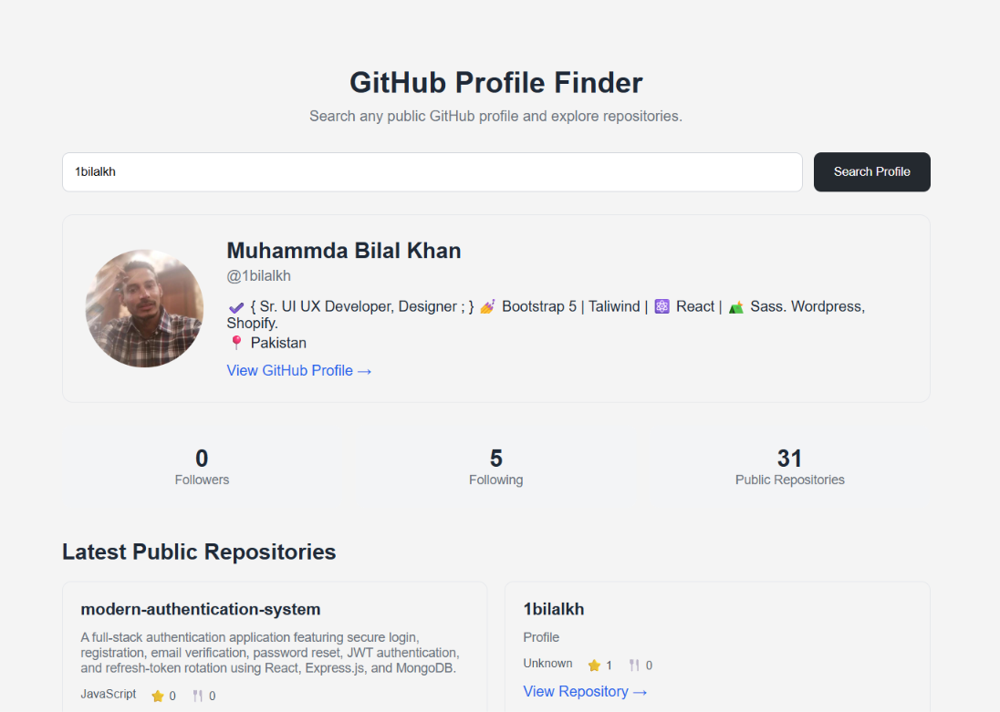

# Full-Stack Task Management App

A full-stack task management application built with Next.js, TypeScript, React, MongoDB, and Mongoose. It allows users to create, view, edit, delete, and complete tasks. It also includes GitHub REST API integration to search public GitHub profiles.

## Features

### Task Management
- View all tasks
- Create new tasks
- Edit task titles
- Delete tasks
- Mark tasks as completed or incomplete
- Persist tasks in MongoDB

### GitHub API Integration
- Search public GitHub profiles by username
- View profile information and statistics
- Display recently updated repositories
- Loading and error handling

## Technologies Used

- Next.js
- React
- TypeScript
- MongoDB
- Mongoose
- GitHub REST API
- CSS

## Installation

Clone the repository:

```bash
git clone https://github.com/1bilalkh/nextjs-task-management-app.git
```

Open the project:

```bash
cd nextjs-task-management-app
```

Install dependencies:

```bash
npm install
```

## Environment Variables

Create a `.env.local` file in the project root:

```env
MONGODB_URI=YOUR_MONGODB_CONNECTION_STRING
```

Replace the placeholder with your MongoDB Atlas connection string.

Never commit `.env.local` or expose database credentials.

## Run Locally

Start the development server:

```bash
npm run dev
```

Open:

http://localhost:3000

## Application Pages

| Page | Description |
|---|---|
| `/` | Home page |
| `/tasks` | Task management |
| `/github` | GitHub profile search |

## REST API Documentation

Base URL: `/api/tasks`

| Method | Endpoint | Description |
|---|---|---|
| GET | `/api/tasks` | Retrieve all tasks |
| POST | `/api/tasks` | Create a task |
| PUT | `/api/tasks/:id` | Update a task title |
| PATCH | `/api/tasks/:id` | Update task completion status |
| DELETE | `/api/tasks/:id` | Delete a task |

## MongoDB Task Schema

```ts
{
  title: {
    type: String,
    required: true,
    trim: true
  },
  completed: {
    type: Boolean,
    default: false
  },
  createdAt: Date,
  updatedAt: Date
}
```

Mongoose timestamps automatically manage `createdAt` and `updatedAt`.

## GitHub API Integration

The application uses the public GitHub REST API:

- `https://api.github.com/users/{username}`
- `https://api.github.com/users/{username}/repos?sort=updated&per_page=6`

It retrieves public profile information and repository details.

## Screenshot



## GitHub Repository

https://github.com/1bilalkh/nextjs-task-management-app
